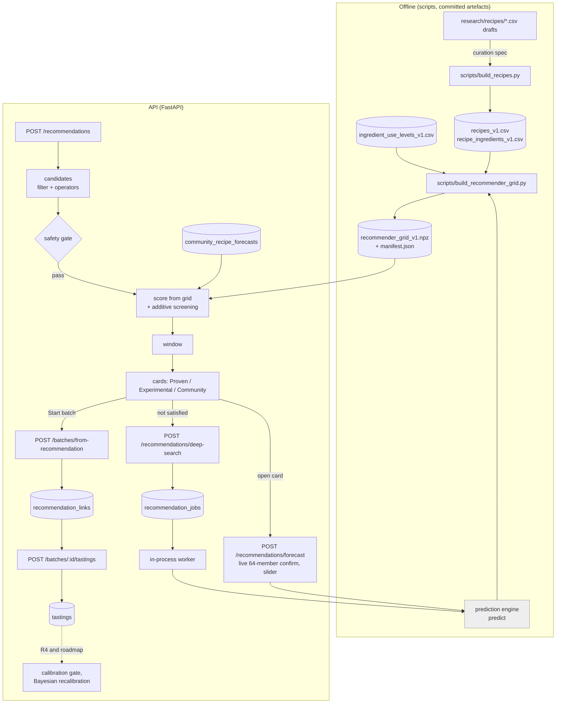
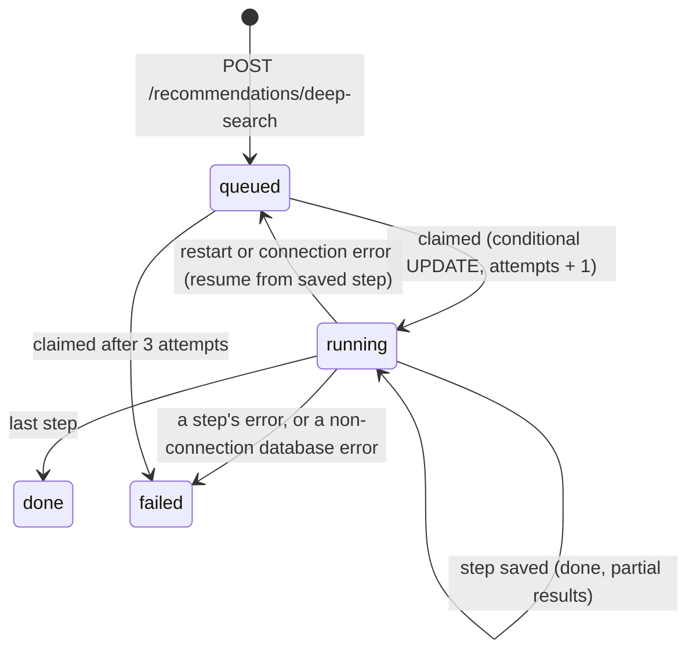

# Fermentation Recommender — Design

**Date:** 2026-10-07
**Status:** IMPLEMENTED (2026-10-13) on branch `feat/recommender-spec`: phases B1–B12 in commits `8241879` (B1) to `9c3f108` (B12), after this spec (`287e897`) and its build plan (`2f0c7bd`); B13 (documentation and code follow-ups) closes the range. The decisions (Q1–Q35) come from a grilling session with the owner on 2026-10-07/08, plus two owner decisions during the build (Q34, Q35). **§ 17 lists every deviation, decision and measured number from the build**; where an owner or orchestrator decision changed the text above it, the text was edited and § 17.1 says where.
**Builds on:**
- `2026-09-24-fermentation-prediction-design.md`: the kinetic ensemble, `predict()`, temperature schedules and milestones.
- `2026-10-02-flavour-nutrition-design.md`: taste activity, odour activity value (OAV), the "noticeable" probability, and its wording rules.
- `2026-10-05-aroma-curation.md`: the 85-compound catalogue, evidence tiers and `AROMA_INGREDIENTS`.
- `2026-09-18-experiment-logging-design.md`: `BatchIngredient` is the recipe.
- `2026-09-29-mobile-and-sharing-spec.md`: anonymous sessions and sharing.

**Companion documents:**
- `docs/ADDING_AN_INGREDIENT.md`: the ingredient plug-in contract.
- `docs/superpowers/research/recipes/BRIEF.md` and `01-*.md`: the curated recipe library drafts.
- `docs/superpowers/specs/2026-10-07-recipe-curation.md`: the library curation spec (R0), written after review of the drafts.

## 1. Problem and goals

The owner wants to start from **a few ingredients and/or a few target aromas** and get **recipes plus a fermentation time** back, in two flavours:
- a **"sure value"**: a proven recipe;
- an **experimental** idea.

Every piece needed already exists except the search itself:
- the forecast only runs forwards (recipe + conditions + time → pH, tastes, 16 aroma series, per member of the ensemble);
- there is no `Recipe` entity;
- the aroma layer already reports, per series, the ensemble probability of being **noticeable**: `derived._aroma_block`, `wn @ (log_v > 0)`.

Goals:

1. **Inputs:** ingredients (hard constraint), 1–3 target aromas or tastes (soft objective), or both.
2. **Three sections of results:**
   - **Proven**: a curated, cited recipe kept inside its documented envelope;
   - **Experimental**: up to 3 documented departures from a parent recipe;
   - **Community, not proven**: recipes users published from their own batches.
3. **Each card** is a full structured recipe with a **temperature-dependent time window**:
   - **taste from**: earliest time to start tasting;
   - **peak**: when the targets are strongest;
   - **stop by**: latest sensible time;

   plus one-click **Start batch**.
4. **Honest labels:** model-guided ideas, never a safety decision, never a validated aroma claim.
5. **Feedback** that makes the recommender measurable and, later, self-calibrating.
6. **Easy to grow:** more ingredients and more recipes plug in through documented, tested contracts.

Constraints:
- numpy/scipy only;
- Render free tier (0.1 CPU, 512 MB, sleeps when idle);
- one solve at a time per process (`_SOLVE_LOCK`);
- the forecast engine stays unchanged except for the two small hooks in § 9.

### Non-goals (v1)

- Cross-type recipes, such as koji plus lacto.
- An "avoid this aroma" input.
- Friendly aroma names ("funky").
- USDA-only ingredients in Proven.
- Automatic recalibration from tastings.
- A trained emulator or true inverse optimisation.
- Cheese ripening.
- Prose method instructions; the existing stage reminders guide the process.

All of these are on the roadmap in § 15.

### What this does not reverse

`IDEATION_CONTEXT.md` killed a "Predictive Flavor Engine". As in the flavour spec, the recommender never says "this will taste like X". It ranks by the **modelled probability that a compound family is noticeable**, and labels that as a model estimate (§ 11).

## 2. Decisions

| # | Topic | Decision |
|---|---|---|
| Q1 | Users | Pantry-first home fermenters ("I have cabbage and ginger"), aroma-first tinkerers ("fruity and funky"), and micro-producers exploring variants |
| Q2 | Modes | Two axes. **Provenance**: the recipe comes from a curated, cited library ("Proven") or departs from it ("Experimental"). **Model confidence**: the profile is `established` or `exploratory`, and the ensemble is uncertain. The library is curated like the aroma catalogue: draft CSVs → curation spec → build script → frozen `*_v1.csv` |
| Q3 | Inputs | Ingredients are **must-include**; staples (salt, water, sugar, flour, tea, starter culture) are always allowed. 1–3 aromas or tastes are a **soft objective**. Either input or both. No "avoid" list in v1 |
| Q4 | Output | Full structured recipe: type, quantified ingredients, salt and sugar, starter, temperature or `temp_schedule`, stages, window. One click creates the culture, batch and ingredients |
| Q5 | Time | A window (taste from / peak / stop by) at a stated temperature that moves with the temperature what-if |
| Q6 | Safety | **Hard gate in every mode** on rules that can be checked from the recipe (§ 7). Predicted pH is never treated as clearance. Every acid-safety card says "measure pH; it must reach ≤ 4.6 within 48 h" |
| Q7 | Vocabulary | All 16 aroma series plus 4 tastes (sour, sweet, umami, alcohol). Series backed by 2 compounds or fewer get a "low resolution" badge. Off-notes are handled by scoring (§ 5.3) |
| Q8 | Labels | Cards are "Model-guided ideas". Each shows provenance, profile confidence, aroma evidence tier, and "model estimate, not validated" |
| Q9 | Ingredients | Curated, model-mapped ingredients by default. USDA foods are allowed in Experimental, labelled "aroma effect unknown". Growth follows the plug-in contract (§ 12) |
| Q10 | Compute | A **precomputed, versioned grid** (§ 8) plus a stateless live forecast per card. An emulator is a later step (§ 15.2) |
| Q11 | Score | The ensemble probability that each target is noticeable, at the peak, averaged over targets. A parent-relative off-note penalty applies to Experimental only. Proven ranks by the central score; Experimental by the optimistic (P90) score |
| Q12 | Window | Formulas in § 6. Proven is clipped to the documented duration. Experimental may run to 1.5× the documented maximum, never before the documented minimum |
| Q13 | Variants | Operators (i) add a flavouring, (ii) swap a base in the same role, (iii) change temperature within the profile range, (v) add a USDA food. **At most 3 operators per variant.** No cross-type |
| Q14 | Feedback | v1: record which recommendation a batch came from, plus a tasting form. Later: Bayesian recalibration (roadmap) |
| Q15 | Evaluation | Offline and online criteria in § 13. Probabilities show as numbers only after the calibration gate; until then Low / Med / High |
| Q16 | Own batch as parent | Yes. Experimental can start from "your batch #n": live forecasts, at most 3 variants per request |
| Q17 | Surface | `POST /recommendations`; Start batch; an **Ideas** page; `GET /recipes` is public read-only (anonymous sessions included) |
| Q18 | Ingredient plug-in | Tiers T0–T3 are derived from what exists (§ 12); `docs/ADDING_AN_INGREDIENT.md`; tests |
| Q19 | Combinations | Additive screening in logit space, confirmed lazily by a live 64-member forecast with an interaction flag; **plus a user-triggered "search deeper"** live run with a waiting message (§ 10.2) |
| Q20 | Ranking | § 5.4. Sections show 3 + 3 (+ 3 community) cards, one per parent per section |
| Q21 | Grid storage | Committed `npz` (float16) with a manifest hash and a staleness test, ≤ 5 MB; becomes a release asset if larger |
| Q22 | Delivery | R0–R4 (§ 14); roadmap § 15 |
| Q23 | Community | Community recipes ship in v1, tagged **"Community — not proven"** |
| Q24 | Deliverables | This spec, `ADDING_AN_INGREDIENT.md`, the recipe-curation spec, and the use-level request in the lacto-ingredients brief |
| Q25 | Single-value sources | Widened to a derived envelope (duration ±30 %, temperature ±3 °C, clipped to the profile range) and labelled "single-value source, widened". Follow-up curation replaces them with sourced ranges |
| Q26 | Source outside model range | The recipe stays Proven and the card shows the source parameters. The model only claims in range: nearest in-range temperature, aroma "early stage only" past the horizon, window from the source alone. A missing value makes the recipe **draft** |
| Q27 | Staged temperatures | Optional `temp_schedule` per recipe. The slider shifts only the first (active) stage |
| Q28 | Search deeper | Background job: in-process FIFO queue, `recommendation_jobs` table, polling, about 20 live 64-member forecasts, one job per user, cached by fingerprint |
| Q29 | Community intake | Published from one's own finished batch, with the tasting form and a pH reading for acid-safety types. Automatic checks, then an admin review queue. Pseudonymous. `DELETE /me` detaches the recipe (disclosed when publishing). Anonymous users may publish |
| Q30 | Community scoring | Forecast once on approval, stored in `community_recipe_forecasts`, recomputed when the grid version changes. Shown in a third section. Usable as Experimental parents. "Community-proven" promotion is on the roadmap |
| Q31 | Sourdough | Sourdough cards **hand off to the existing planner**: Start opens `/sourdough/plan` pre-filled with the style, and the window is the planner's forecast. The 7 sourced catalogue styles are active; poolish, biga and Type III are excluded. Sourdough variants use operators (ii) and (iii) only |
| Q32 | Unmapped species | A fish missing from the catalogue (Pacific sand lance) is booked as `Anchovies`, labelled "stand-in species" |
| Q33 | Delivery of this spec | Committed on `feat/recommender-spec`; PR after owner review |
| Q34 | Export of recommendation links (2026-10-09) | Recommendation links are **not** included in `/me/export`; tastings are |
| Q35 | Calibrated display (2026-10-13) | The number shown once calibrated is P (noticeable) at the peak; "model estimate, not validated" stays alongside "calibrated on n batches" |

## 3. Architecture



**Code layout:** a new package, `src/fermenttrack/recommender/`, with one module per concern:
- `library.py`: load and validate the frozen CSVs;
- `gate.py`: the safety gate;
- `operators.py`: the variant operators;
- `score.py`: scoring;
- `window.py`: the time window;
- `grid.py`: grid read and manifest;
- `screen.py`: additive screening;
- `jobs.py`: the job queue;
- `service.py`: orchestration.

**Routers:**
- `routers/recipes.py`;
- `routers/recommendations.py`;
- `routers/community.py`;
- `routers/tastings.py`, or the tastings endpoints added to `batches.py`.

## 4. Recipe library (R0)

### 4.1 Files and pipeline

The pipeline mirrors the aroma catalogue exactly:

| step | aroma catalogue | recipe library |
|---|---|---|
| shared research rules | `research/aroma/BRIEF.md` | `research/recipes/BRIEF.md` |
| research output | `research/aroma/0x-*.md` | `research/recipes/01-<group>.md` and `*_draft_v0.<group>.csv` |
| curation (owner review) | `specs/2026-10-05-aroma-curation.md` | `specs/2026-10-07-recipe-curation.md` |
| build | `scripts/build_aroma_compounds.py` | `scripts/build_recipes.py` |
| frozen artefact | `prediction/aroma_compounds_v1.csv` | `recommender/recipes_v1.csv` and `recommender/recipe_ingredients_v1.csv` |

**Frozen means frozen:** a change is `_v2` plus a new grid. Only the build script writes the `_v1` files. It reads the research drafts and applies the curation spec's decisions, which are encoded as data in the script, each with a comment citing its curation section; tests check the result against the curation spec's tables (B1, 2026-10-08; § 17.2).

### 4.2 Schema

`recipes_v1.csv` uses the same columns as `research/recipes/BRIEF.md`, plus three:
- `temp_schedule` (Q27): optional, of the form `0:20;48:4`, meaning "from hour 0 at 20 °C, from hour 48 at 4 °C". It is the source's staged temperatures when they are given.
- `envelope_basis` (Q25): `sourced` or `widened_single_value`.
- `model_scope` (Q26): any of `in_range`, `temp_outside_profile`, `beyond_horizon`, semicolon-separated. The build script derives it from `profiles.py`.

`recipe_ingredients_v1.csv` uses the brief's columns. Every `ingredient` must resolve to a catalogue `Ingredient.name`; `new` rows block `active` status until the ingredient exists at tier T0 or above (§ 12).

### 4.3 Status and provenance

- **Provenance tiers:** `institutional_tested` > `peer_reviewed` > `traditional_documented`. Blogs are leads, never data.
- **`active`** requires every number on the card to be sourced, or derived with the derivation shown. A missing value (for example, no stated temperature) keeps the recipe **draft**. Draft recipes are never served.
- **Q25 widening:** a single-value duration *d* becomes [0.7 *d*, 1.3 *d*], and a single temperature *T* becomes [*T* − 3, *T* + 3]. Both are clipped to the profile's `temp_range`, and `envelope_basis = widened_single_value`.
- **Q26:**
  - **Temperatures (B5, 2026-10-08):** a recipe is served and booked at its **source temperature**: the user's temperature, else the recipe median, clamped only to the documented span, the gate and the koji caps (≤ 35 °C with certified tane-koji as the only starter, otherwise ≤ 33 °C). The model's statistics run at a model temperature `model_c`, and the card says which:
    - on **cards** (grid statistics), it is the nearest **grid** temperature;
    - in the **live forecast** (slider), it is the nearest **in-range** temperature, the profile range.
  - when the recipe's **served temperature** is outside the profile range, the **window comes from the source alone**: taste from = *d*_lo, peak = *d*_med, stop by = *d*_hi. The card names the documented temperature and the range the model covers, for example "timings from the source at 21–22 °C (the model covers 28–32 °C); aroma levels are computed at 28 °C". When only part of the documented span is outside, the model window applies as usual;
  - if the duration exceeds `profile.horizon_h`, aroma scores and peak are computed only up to the horizon, the card says "aroma estimate covers the first *H* days only", and taste-from and stop-by come from the source.

### 4.4 State of the drafts (2026-10-07)

- **All research groups are in:** 20 servable recipes (`2026-10-07-recipe-curation.md`):
  - 13 curated recipes across lacto, kombucha, koji, miso, garum, kefir, cheese and vinegar;
  - 7 sourdough catalogue styles that hand off to the planner (Q31).
- **Envelope findings:**
  - kombucha at 30 °C is above the profile's 20–28 °C;
  - koji sources run 27–40 °C against a profile range of 28–35 °C;
  - lactic cheese sets at 21–22 °C against the profile's 28–32 °C;
  - cider vinegar runs 15.6–26.7 °C against the profile's 24–30 °C;
  - red miso (6–12 months) and fish sauces (10–18 months) run far beyond their horizons;
  - budu has no stated temperature, so it goes to draft under Q26;
  - several peer-reviewed rows are single values (Q25).

## 5. Candidates and scoring

### 5.1 Request

```json
{"ingredients": ["Napa cabbage", "Fresh ginger"], "aromas": ["fruity", "pungent"],
 "tastes": ["sour"], "mode": "both", "temperature_c": null, "parent_batch_id": null,
 "usda_fdc_ids": []}
```

- `mode` is one of `proven`, `experimental` or `both`.
- At most 3 targets in total, across aromas and tastes.
- `temperature_c`: the user's kitchen, if given; otherwise each recipe's own.
- `parent_batch_id` (Q16) needs an owned batch.
- `usda_fdc_ids` feed operator (v) only.

### 5.2 Candidate generation

**Proven:** active library recipes that contain every must-include ingredient (staples aside) and pass the gate (§ 7).

**Experimental:** parents are active library recipes, approved community recipes, or the user's own batch. Variants apply up to **3 operators** (Q13):

| op | change | bounds |
|---|---|---|
| (i) add | add one flavouring at its typical use level | `ingredient_use_levels_v1.csv` (tier T3 only); same ferment type |
| (ii) swap | replace a base or flavouring with another of the same `role` and type | target is tier T2 or above; mass kept |
| (iii) temperature | move the active stage temperature | inside `profile.temp_range`, outside the recipe's documented range, and through the gate |
| (v) USDA | add a picked USDA food at ≤ 10 % of the mass, "aroma effect unknown" | tier T0 or T1; Experimental only |

**Every operator keeps the salt (and sugar) % w/w of the new total constant** by rescaling those rows, so adding mass never dilutes the salt below the gate.

A must-include ingredient that isn't in the parent is added by operator (i) or (v). Such a variant counts that operator towards its 3.

### 5.3 Score

Notation:
- *A* = the targets (aroma series and/or tastes);
- member *n* has weight *wₙ*;
- *Lₙ,ₛ(t)* = log₁₀ odour activity summed over the series (aroma), or log₁₀ activity ratio (taste); both come from the engine.

A soft per-member indicator keeps the score continuous (τ = 0.25 log₁₀ units, a configuration constant):

$$S_n(t) = \frac{1}{|A|}\sum_{s\in A} \sigma\!\left(\frac{L_{n,s}(t)}{\tau}\right)$$

- **Central score:** $E(t) = \sum_n w_n S_n(t)$. As τ → 0 this is exactly Q11's mean noticeable probability, the same quantity the forecast panel shows.
- **Optimistic score:** $U(t)$ = the weighted 90th percentile of $S_n(t)$.

> Implementation note on Q11: "Proven ranks by the median" is implemented as the ensemble **expectation** *E*. With 1–3 targets, the per-member score is close to binary, so a median would jump between 0 and 1 and make ranking unstable. *U* is the P90 as agreed.

**Off-note penalty (Experimental only):**
- Off-note candidates: *O* = {solvent, sulfurous, fishy, cheesy, phenolic}, minus the user's targets.
- The parent's **character series** *C* are its `reported_aromas` plus any series with *P* ≥ 0.5 in the parent at its documented median duration. A sulfurous kimchi is never penalised for being sulfurous.
- The penalty:

$$\text{pen} = \lambda\sum_{o\in O\setminus C}\max\big(0,\;P^{\text{var}}_o(t^*) - P^{\text{par}}_o(t^*)\big),\quad \lambda = 0.5$$

**No targets** (ingredients only): there is no score. Ranking falls through to the next keys in § 5.4.

### 5.4 Ranking and display (Q20)

**Proven:** sort by
1. *E*(peak), when there are targets;
2. fewest ingredients to buy that the user didn't list;
3. provenance tier;
4. profile confidence (`established` first).

**Experimental:** sort by *U*(peak) − pen, then the same keys 2–4. Unconfirmed combinations (§ 10.1) rank on their screened score.

**Community:** sort by *E*(peak), then the number of tasted batches, then mean liking.

**Display:**
- 3 cards per section, at most one per parent recipe in each section;
- if no Proven recipe qualifies, the Proven section says so and Experimental fills the screen;
- until the calibration gate (§ 13.2), the score shows as **Low / Med / High** (*E* < 0.33, < 0.67, ≥ 0.67), never as a number.

## 6. Time window (Q5, Q12)

Notation:
- *d*_lo, *d*_med, *d*_hi: the recipe's documented duration (widened under Q25 if needed);
- *H*: the profile horizon.

**Safety milestone time:** *t*_safe = the weighted 90th percentile, over members, of the first time the profile's safety milestone is crossed (pH below 4.6 where `ph_safety_line`), else 0. It only delays tasting. **It is never shown as a clearance.**

**Window, in order:**

| point | rule |
|---|---|
| taste from | max(*d*_lo, *t*_safe) |
| peak | with targets: argmax of *E*(t) over [taste from, min(*t*_max, *H*)]. Without targets: *d*_med × *m*(T_user) / *m*(T_source), where *m* is the median time to the profile's main milestone at that temperature (the kinetic time shift) |
| stop by | the earliest of: *t*_max; the first *t* > peak with *E*(t) < 0.8 · *E*(peak); the first *t* > taste from where an off-note in *O* \ *C* reaches *P* ≥ 0.5 |

- **Ceiling:** *t*_max = *d*_hi (Proven, Community) or 1.5 · *d*_hi (Experimental). Taste from is never earlier than *d*_lo in any mode.
- **Temperature dependence:** the grid holds 3 temperatures. The card interpolates the window linearly in temperature between them, and the slider calls the live forecast (§ 10.1).
- **Staged recipes** (Q27): the slider shifts only the first stage.

## 7. Safety gate (Q6)

`gate.check(recipe_or_variant, temperatures) -> GateResult(ok, reasons)` evaluates every rule that can be checked from the recipe, **at every temperature the card can show** (schedule knots, grid temperatures, slider range). Any failure removes the candidate in every mode. Reasons go to a debug field only.

| rule (`risk_rules.yaml`) | recipe check | applies to |
|---|---|---|
| SALT-001, SALT-002 | salt % w/w within [2.0, 10.0]. **Treated as a gate**, although the rules are warnings in batch safety | `lacto_ferment` only. The rules say "vegetable"; the batch safety service maps every non-koji type to `lactic`, which would flag miso and garum salt. This mapping stays explicit here |
| TEMP-001 | every temperature ≤ 45 °C | lactic types |
| KOJI-002 | every temperature ≥ 25 °C | koji |
| KOJI-001 | no temperature > 33 °C unless the recipe's starter is `Koji spores (A. oryzae)`, the certified tane-koji exception. The card says "use certified tane-koji" | koji |
| BOT-001, BOT-002 | not checkable from a recipe (they need pH). **Acid-safety types** (`lacto_ferment`, `kombucha`, `kefir`, `cheese`, `vinegar`; Q6 "every acid-safety card") **must** carry "Measure pH. It must reach ≤ 4.6 within 48 h at > 10 °C; if not, discard", and the batch's own safety advisory applies once started | acid-safety types |
| pH measurement | every acid-safety card includes "log pH by 48 h", and Start batch creates that reminder | acid-safety types |
| salt and temperature barriers (2026-10-08, B3 review) | `koji`, `miso` and `garum` are not made safe by acidity: rice koji is harvested at 42–48 h near pH 6; miso and fish sauce rely on salt and water activity. Their cards carry **no pH-deadline line**. Instead: koji gets the KOJI-001/002 temperature line ("Keep the bed at 25–33 °C; up to 35 °C only with certified tane-koji"), plus the tane-koji line; miso and garum get "Safety comes from salt, not acidity: do not reduce the salt" (BCCDC koji and miso guideline: miso salt at least 4 %; Codex CXS 302-2011 for fish sauce). **Sourdough** cards carry no safety line: baking is the barrier, its profile has no pH safety line, and the card hands off to the planner. The batch safety service still maps these types to `lactic` / `enzymatic_koji` (BOT-002); that predates this work and is raised separately | koji, miso, garum, sourdough |
| SALT-BARRIER (2026-10-09, B9; owner decision, no rule in `risk_rules.yaml`) | Salt % w/w must be at least:<ul><li>**4.0** for miso, per the BCCDC koji and miso guideline p. 14 ("at least 4 %");</li><li>**8.3** for garum. No source states a minimum, so this is the lowest salt among the sourced garum recipes: the Pacific sand lance fish sauce's 8.3–15.4 % (Jung et al. 2022). Budu runs 20–23 %.</li></ul>The minimum must hold both with and without the optional rows. An unknown salt % (a missing, non-finite or negative mass) fails closed. It applies on every path: Proven, variants, own-batch parents, community publishing, approval and serving | miso, garum |

**Also gated:**
- Operator (iii) never leaves `profile.temp_range`.
- Operator (v) needs the type to be a salted or acidified one (`lacto_ferment`, `kombucha`, `kefir`, `vinegar`, `miso`, `garum`), keeps the share ≤ 10 %, and passes the salt rule after rescaling.

## 8. Precomputed grid (Q10, Q21) — how to build and regenerate

### 8.1 Contents

For every active library recipe, every **single** operator applied to it, and 3 temperatures (`temp_range[0]`, `temp_c`, `temp_range[1]`; a recipe's documented temperature replaces the nearest of the three):
- **per series** (16 aroma + 4 taste), at 24 log-spaced times from 1 h to `min(1.5·d_hi, H)` plus *d*_lo, *d*_med and *d*_hi:
  - *E*ₛ(t) = Σ wₙ σ(Lₙ,ₛ/τ);
  - *U*ₛ(t) = the weighted P90 of σ(Lₙ,ₛ/τ);
  - *P*ₛ(t) = Σ wₙ 1[Lₙ,ₛ > 0];
- **milestones:** the P10, P50 and P90 crossing times for each profile milestone;
- **metadata:** the `not_modelled` ingredients and the evidence tier of the top compound per series, for card labels.

**Approximation used online:** *U* for several targets is taken as the mean of the per-series *U*ₛ. This is an approximation, **not a bound**: quantiles don't add across series. It is documented on the card as "optimistic", and B7's live confirmation computes the exact per-member P90.

### 8.2 Size and format

- About 30 recipes × (1 + ~20 operators) × 3 temperatures ≈ 1.9 k forecasts.
- Storage: 20 series × 3 statistics × ~27 times × 2 bytes ≈ 6.5 kB per forecast, so ~12 MB raw, and roughly 3–5 MB after `numpy.savez_compressed`.
- **Budget: ≤ 5 MB committed.** Over budget, the `npz` becomes a GitHub release asset, fetched at deploy and checked against the manifest hash (Q21 b).

### 8.3 Manifest and staleness test

`recommender_grid_v1.manifest.json` records:
- `MODEL_VERSION`;
- sha256 of `profiles.py`, `aroma_compounds_v1.csv`, `aroma_data.py`, `recipes_v1.csv`, `recipe_ingredients_v1.csv` and `ingredient_use_levels_v1.csv`;
- τ, the temperatures, the time grid, the operator list, the build date, the build duration and the members per forecast (160).

`tests/test_recommender_grid.py::test_grid_is_current` recomputes the hashes and fails with "grid is stale: run `python scripts/build_recommender_grid.py`" on any mismatch. A second test checks the size budget.

### 8.4 Procedure

1. Change any input above. That is the trigger; the staleness test will fail.
2. Run `python scripts/build_recommender_grid.py --workers N`.
   - It runs `predict()` per entry with no readings and the recipe as `RecipeIn` rows, through the planned-schedule hook (§ 9).
   - Workers are separate processes, each with its own `_SOLVE_LOCK`.
   - It is deterministic, because `predict` is seeded by the input fingerprint.
   - It writes the `npz` and the manifest, and prints the size and the slowest entries.
3. Commit both files together with the input change, in the same PR.
4. Approved community forecasts (§ 10.3) are recomputed by the job queue at the first startup whose manifest hash differs from the stored `grid_version`.

**Expected cost:** about 1.9 k forecasts at roughly 0.5–2 s each on a dev core (with aroma), so about 30–60 min single-core and minutes with workers.

### 8.5 Additive screening for 2–3 operators (Q19)

For a combination *K* of single operators on parent *p*, per series *s* and time *t*:

$$\operatorname{logit}\hat E_s^{K}(t) = \operatorname{logit}E_s^{p}(t) + \sum_{k\in K}\big[\operatorname{logit}E_s^{p+k}(t) - \operatorname{logit}E_s^{p}(t)\big]$$

- Logits are clipped to ±6, and *U* is screened the same way.
- **Card labels:** screened combinations show "screened" until confirmed. Confirmation is a lazy live forecast with 64 members (§ 10.1). If the confirmed *E*(peak) < 0.8 × the screened value, the card says "interaction detected".
- **Learning:** confirmed results are cached by fingerprint and logged as candidates for the next grid or emulator training set (§ 15.2).

## 9. Engine hooks (small, additive)

1. **Planned temperature:** `PredictionInputs.planned_temperature: tuple[tuple[float, float], ...] = ()`.
   - `_schedule` uses it instead of the constant estimate when there are no readings. A what-if override shifts only the first stage.
   - It is left out of the fingerprint when empty, the same pattern as `population_priors`, so existing caches and seeds don't change.
2. **Ensemble size:** `predict(..., members: int | None = None)` sets the ensemble size for confirmations and deep search (64). It is part of the output cache key.

Nothing else in `prediction/` changes. A recipe becomes `RecipeIn` rows exactly as a logged batch does, through `composition` / FDC `per_100g`.

## 10. Live paths

### 10.1 Per-card forecast — `POST /recommendations/forecast`

Stateless, like `POST /sourdough/plan`.
- **Input:** the card's structured recipe plus `temperature_c`.
- **Run:** `predict()` with 64 members, reusing the existing output caches.
- **Output:** the window, *E* and *U* at the peak, and the series bands for a small chart.
- **Used for:** the temperature slider, confirming screened combinations, and own-batch parents (Q16, at most 3 variants per request).

### 10.2 Search deeper — background job (Q19, Q28)

Shown under the results as "Not what you wanted? Search deeper (takes a few minutes)".

**Endpoints:**
- `POST /recommendations/deep-search` returns `202 {job_id}`.
- `GET /recommendations/jobs/{id}` returns `{status, done, total, eta_s, results[]}`. Partial results are included; cards appear as each one is confirmed.

**What it runs:** up to **20 live 64-member forecasts**, in this order:
1. the best screened combinations not yet confirmed;
2. 2 extra temperatures per top parent;
3. variants with the user's USDA foods (operator v).

**How it runs:**
- A single in-process `asyncio` worker started at app startup consumes a FIFO queue persisted in `recommendation_jobs`. Each solve goes through the threadpool (the solve lock is respected).
- One active job per owner.
- On startup, jobs left `queued` or `running` are re-queued; Render free instances sleep after idle.

**Waiting message (front end):** "Exploring 7 / 20 combinations — about 3 min left. You can leave this page; results are kept." The page polls every 5 s while visible. Polling keeps the instance awake; a backgrounded tab may let it sleep, and the job then resumes on the next wake.

**Results** are stored under the request fingerprint (repeating the request is instant) and logged as grid and emulator candidates.

**Escalation:** a separate worker or queue (Redis or similar) only if the median queue wait exceeds 10 min.

### 10.3 Community recipes (Q23, Q29, Q30)

**Publish:** `POST /community-recipes {batch_id, title, pseudonym}`.
- **Source:** only from one's own **finished** batch. The recipe is that batch's `BatchIngredient` rows, the mean of its logged temperatures (or its expected temperature) and its actual duration.
- **Automatic checks:**
  - the tasting form (§ 11.2) is filled in;
  - acid-safety types have a logged pH ≤ 4.6;
  - the gate (§ 7) passes;
  - every ingredient is in the catalogue (USDA picks allowed, labelled);
  - the masses balance to 1000 g/kg ± 5 %;
  - the type is not `generic`.
- **Then:** `status = pending`.

**Review:** `GET /admin/community-recipes?status=pending`, then `POST /admin/community-recipes/{id}/approve|reject {reason}`.
- Admin is the existing allow-list of Supabase user ids (`sub`) in `FERMENTTRACK_ADMIN_USER_IDS`, checked by `auth.require_admin`; no role system exists yet. (Build plan § 0: this supersedes the `FERMENTTRACK_ADMIN_SUBS` first proposed here.)
- Approval enqueues one forecast job per grid temperature into `community_recipe_forecasts` (same statistics as the grid).

**Display:** a third section, **"Community — not proven"**.
- The card shows the pseudonym, "made *n*×" (tasted batches started from it) and mean liking.
- Community recipes can be **parents** for Experimental; their variants' parent is labelled "community recipe".

**Privacy:** publishing shows "Your recipe stays in the library if you delete your account; it is detached from you". `DELETE /me` nulls `owner_id` and `source_batch_id` and keeps the pseudonym. Anonymous users may publish. Recipe content is not personal data once detached. `/me/export` includes the user's published recipes.

**Roadmap:** promotion to "community-proven" (§ 15).

## 11. Cards, labels, feedback

### 11.1 Card

| element | content |
|---|---|
| header | name; ferment type; section badge (Proven / Experimental / Community — not proven); for Experimental, the operator chips ("+ ginger 2 %", "24 → 27 °C", "+ USDA: persimmon, aroma effect unknown") |
| recipe | quantified ingredients scaled to a batch size the user picks (default 1 kg); salt or sugar %; starter; temperature or schedule; stages |
| window | taste from / peak / stop by at T °C, with a temperature slider |
| why | target series as Low / Med / High (numbers after the gate); top contributing compounds with evidence tiers (from the engine's compound list); "low resolution" on phenolic, vinegary and fishy |
| trust | provenance tier and sources (Proven); profile confidence; "model estimate, not validated"; Q25 and Q26 labels; "screened" or "interaction detected"; "aroma effect unknown" |
| safety | the gate's mandatory lines (§ 7) |
| actions | **Start batch**; open forecast; copy as share link (the read-only plan pattern) |

**Wording rules** follow the flavour spec § 7: "likely noticeable", never "tastes like".

### 11.2 Feedback (Q14)

**Start batch:** `POST /batches/from-recommendation {card, culture_id?}`. In one transaction it:
- reuses the existing creation services to create or select a culture of the type, the batch (with expected temperature or schedule) and its `BatchIngredient` rows;
- creates the pH reminder;
- writes a `recommendation_links` row: `batch_id` (PK, FK), `source_kind` (library / variant / community / own_batch), `recipe_key` or `community_recipe_id`, operators (JSON), mode, temperature, the predicted window, per-target *E* and *U*, `grid_version`, `created_at`.

**Sourdough exception (Q31):** a sourdough card's Start opens the planner (`/sourdough/plan`) pre-filled with the style. The planner creates the batch, and it carries the card id through so the planner's save writes the same `recommendation_links` row.

**Tasting form**, offered at stop-by and when the batch is finished: `POST /batches/{id}/tastings` writes a `tastings` row with:
- `t_h`;
- a 0–3 rating for each target series and taste (0 = not noticed … 3 = strong);
- overall liking (1–5);
- `make_again` (bool);
- optional free-text notes.

Every batch can have tastings, not only recommended ones; the comparison baseline needs those.

**Roadmap:** tastings drive Bayesian recalibration (§ 15.1).

## 12. Ingredient plug-in contract (Q9, Q18)

An ingredient's tier is **derived** by `recommender.library.ingredient_tier(name, ferment_type)`, never from a hand-kept list:

| tier | exists when | unlocks |
|---|---|---|
| T0, catalogue | an `Ingredient` row (seed-data version + migration) | Experimental only: operator (v), "aroma effect unknown" |
| T1, kinetics | an FDC nutrient link (the 0018 pattern) | moves sugars, pH and the window |
| T2, aroma | an `AROMA_INGREDIENTS` entry with curated priors on catalogue compound keys | serves aroma targets; target of operator (ii) |
| T3, recommender-ready | a row in `ingredient_use_levels_v1.csv` (`ingredient,fermentation_type,role,share_median,share_lo,share_hi,source,notes`) | operator (i) can add it |

**Step-by-step:** `docs/ADDING_AN_INGREDIENT.md`.

**Tests:**
- every `AROMA_INGREDIENTS` key is a catalogue name or a documented alias;
- every use-level row resolves to T2;
- every library ingredient is T0 or above;
- the grid is stale after any of these files changes (§ 8.3).

**Link to the other worktree:** the lacto-ingredients research round (`feat/aroma-lacto-ingredients`) already asks for "typical use level". Its brief now asks for it in the T3 column format, so its results drop straight into `ingredient_use_levels_v1.csv`.

## 13. Evaluation and acceptance criteria (Q15)

### 13.1 Offline, run in CI on the committed grid

| id | criterion | target |
|---|---|---|
| E1 | For each active library recipe with **at least one non-staple core ingredient**, querying its core (non-staple) ingredients in Proven returns it in the top 3. Recipes whose core is all staples (the sourdough styles, the kombuchas) have no ingredient query and are listed separately, not counted as misses (B5, 2026-10-08) | ≥ 90 % of eligible recipes |
| E2 | For each recipe with source-reported aromas, querying those aromas with no ingredients returns it in the top 5 | ≥ 60 % |
| E3 | The **unclipped** model window [taste from, stop by] overlaps the documented [*d*_lo, *d*_hi]. Proven windows are clipped by design, so E3 is measured before clipping | ≥ 80 % |
| E4 | Safety property test: for every grid entry and 2 000 seeded random operator combinations (numpy RNG, no new dependency), every served candidate passes `gate.check`, and every served card carries the mandatory safety lines | 0 violations |
| E5 | Determinism: the same request gives the same cards, and the same request and grid give byte-identical JSON | exact |
| E6 | Latency, `POST /recommendations` from the grid, warm: p95 on Render | ≤ 1.5 s |

E1–E3 are reported as numbers with their *n*, so they are not pass/fail only, and tracked in the curation spec.

### 13.2 Online: the calibration gate (R4)

Once **≥ 30 tasted batches** carry a recommendation link:
- **Score:** the Brier score of *P*ₛ(t_tasting) against "noticed" (rating ≥ 1), over every target in every tasting.
- **Baseline:** a per-type, per-series noticed rate (leave-one-batch-out).
- **Pass** (both conditions, on the same 2 000 batch-level resamples):
  - the upper bound of the paired-bootstrap 90 % CI of (Brier_model − Brier_baseline) is < 0;
  - **and (B11 review, 2026-10-13)** the 5th percentile of the bootstrap AUC of P against "noticed" is > 0.5. The AUC compares ratings **within each (type, series) cell**, so it is a pooled within-cell Mann–Whitney with ties counted as ½. A resample whose cells all lack one class counts as 0.5, the conservative choice.
  - **Why the AUC condition:** the leave-one-batch-out baseline carries a built-in penalty of about π(1−π)/n. In simulation, a model that only knows each type's base rate passed the Brier condition alone 29–54 % of the time; with the AUC condition that drops to about 0 %, while real models keep their power. An AUC over all ratings together would still pass base-rate models 30–42 % of the time when types differ, because P separates the types; within cells a base-rate model's AUC is exactly 0.5.
  - **Privacy:** `GET /recommendations/calibration` (any signed-in user, anonymous sessions included) hides every score and per-bin value below 30 batches. It also hides the per-bin values of any bin whose ratings come from fewer than 3 distinct batches (B13, 2026-10-13: this was 3 ratings, but one batch tasted three times is still one person's). Admins read the full report at `GET /admin/calibration`. Numbers turn off if the latest report is older than 14 days.
- **Reporting:** a reliability diagram with 5 bins, and the number of batches and ratings.

Until the gate passes, scores show as Low / Med / High. After it passes, the numbers appear with "calibrated on *n* batches". The gate re-runs weekly, and numbers turn off again if it fails.

## 14. Delivery increments (Q22)

| inc | scope | done when |
|---|---|---|
| R0 Library | curation spec from the drafts (owner review); `build_recipes.py`; `recipes_v1.csv`, `recipe_ingredients_v1.csv`; `library.py` with validation tests; `GET /recipes` | about 25–30 active recipes over 9 types, schema tests green |
| R1 Proven | engine hooks (§ 9); `gate.py`; grid builder (the sourdough styles via `bake.py`) and staleness test; `score.py`, `window.py`; `POST /recommendations` (Proven); `POST /recommendations/forecast`; `POST /batches/from-recommendation` and `recommendation_links`; sourdough hand-off to the planner; Ideas page | E1, E3 (Proven), E4–E6 green |
| R2 Experimental | `operators.py` (i, ii, iii, v); `ingredient_use_levels_v1.csv`; tiers T0–T3 and `ADDING_AN_INGREDIENT.md` tests; screening; Experimental section; own-batch parent; deep-search jobs and waiting UI | E2, E4 over variants, job lifecycle tests green |
| R2b Community | publish, admin queue, `community_recipe_forecasts`, third section, `DELETE /me` and `/me/export` handling | publish, approve and serve tests; privacy tests |
| R3 Feedback | `tastings` table and form; reminders at stop-by | form shipped; tastings exported in the `/me/export` JSON (B10: there is no FermentJSON export to extend) |
| R4 Gate | calibration job, reliability report, Low/Med/High ↔ numbers switch | § 13.2 implemented; gate decision logged |

Each increment gets its own plan in `docs/superpowers/plans/` and its own PR. Tests co-land with each one.

## 15. Roadmap (after v1)

### 15.1 Bayesian recalibration from tastings (Q14 c)

Treat each rating as an ordinal observation of *L*ₛ at tasting time: P(rating ≥ k) = σ((*L*ₛ − θ_k)/τ_obs). Update the aroma priors that matter most per series, chiefly the odour thresholds and route yields (`Prior`s in `aroma_data`), using the same importance-weighting machinery the forecast already uses for pH, gravity and Brix (`inference.py`). The result is pooled into population priors the way `BatchEvidence` pools kinetic parameters.

**Ships only after:** the R4 gate exists to measure it, a held-out comparison shows lower Brier than the un-recalibrated model, and the owner reviews which parameters may move.

### 15.2 Emulator and true inverse optimisation (Q10 c)

- **Training data:** the grid, confirmed screenings, deep-search results and community forecasts. Everything logged from § 8.5 and § 10.2 serves this.
- **Inputs:** type, ingredient mass shares in the mapped feature space (T2 ingredients), salt, temperature (or schedule features), and time.
- **Outputs:** per-series logit *E*ₛ(t) and *U*ₛ(t), plus milestone times.
- **Model:** a Gaussian process per type (scikit-learn, or plain numpy at this size), or a small multilayer perceptron if the data outgrows a GP.
- **Validation:** on held-out live forecasts, R² on the logits and 90 % interval coverage.
- **Use:** Bayesian optimisation of continuous proportions **inside** the gate and the envelope, with the winners confirmed by a live forecast before showing. It replaces the additive screening when it beats it on held-out combinations.

### 15.3 Other items

- **Cross-type variants**, such as a koji-boosted lacto ferment. This needs the engine to run a chain of profiles.
- **"Avoid this aroma"** as a negative target.
- **Friendly aroma names** that map to series ("funky" = cheesy + sulfurous + pungent).
- **USDA ingredients in Proven** once they reach T2 and appear in a sourced recipe.
- **Community-proven tier:** a community recipe with ≥ 10 tasted batches from ≥ 3 distinct users, mean "make again" ≥ 0.7, and calibrated predictions (gate passed for its type) becomes "Community-proven", still separate from source-proven.
- **Follow-up curation (Q25):** replace widened single-value envelopes with sourced ranges.
- **Engine track (Q26):** extend profile ranges and horizons (kombucha at 30 °C, koji at 27–40 °C, long miso and fish sauce), owned by the engine track, not the recommender.

## 16. Risks and open items

- **Unvalidated model.** Mitigation: the labels, the numbers-after-calibration rule, and source-anchored windows for Proven.
- **Exploratory types** (koji, miso, garum) may rank on sketch-level forecasts. Mitigation: profile confidence is a ranking key and is shown on the card.
- **Grid size or build time** could grow with the library and operators. Mitigation: the § 8.2 budget, the release-asset fallback, and the emulator later.
- **Render sleep** interrupts deep-search jobs. Mitigation: persisted queue, resume on startup, user-visible status.
- **Safety-service scope mismatch:** salt rules apply to all `lactic` types in batch safety. This is noted, not fixed here; the recommender's gate scopes them to `lacto_ferment`. Raise it as a separate fix.
- **Admin:** there is no role system. The `FERMENTTRACK_ADMIN_USER_IDS` allow-list is the minimum; revisit with account claiming.

## 17. Implementation notes (2026-10-13)

Built in phases B1–B13 under `docs/superpowers/plans/2026-10-08-recommender-build.md`, whose § 5 is the handoff log (review rounds, accepted deviations, measured numbers). This section gathers what the build changed or decided, by section of this spec. Names in `code` are the shipped modules, constants and tests.

### 17.1 Phases, migrations and text changed

| phase | scope | commit |
|---|---|---|
| B1 | recipe library (R0) | `8241879` |
| B2 | engine hooks (§ 9) | `fd919d6` |
| B3 | gate, score, window | `27a704a` |
| B4 | grid v1 | `f4364d9` |
| B5 | Proven API | `8e78b20` |
| B6 | Ideas page, Proven | `f7c460d` |
| B7 | Experimental backend | `4c18db4` |
| B8 | search deeper | `5ef3cd3` |
| B9 | community recipes | `f6393e5` |
| B10 | tastings | `b653742` |
| B11 | calibration gate | `f42aeaf` |
| B12 | frontend R2–R4 | `9c3f108` |
| B13 | docs; code follow-ups from the handoffs | last commit of the branch |

**Migrations:**
- `0019`: `recommendation_links`, and `reminders.kind`;
- `0020`: `recommendation_jobs`;
- `0021`: `community_recipes`, `community_recipe_forecasts`, plus `recommendation_links.community_recipe_id` (now a foreign key) and `parent_batch_id`;
- `0022`: `tastings` and `recommendation_links.p_series`;
- `0023`: `calibration_reports`.

**Code layout (§ 3), as shipped:**
- `recommender/`: `library`, `gate`, `operators`, `score`, `window`, `grid`, `screen`, `jobs`, `service`, plus:
  - `run.py`: how a recipe runs through the engine, shared by the grid builder and the live paths;
  - `community.py`;
  - `calibration.py`.
- Routers: `recipes`, `recommendations` (which also carries the calibration routes), `community` and `tastings`. `me.py` gained `GET /me/community-recipes`.

**Text edited because of an owner or orchestrator decision:**
- § 4.1: the build reads the drafts plus the encoded curation decisions (B1).
- § 10.3 and § 16: admin is `FERMENTTRACK_ADMIN_USER_IDS` with `auth.require_admin` (build plan § 0). The obsolete note on the `feat/admin` branch was removed.
- § 14, R3: tastings are exported in the `/me/export` JSON (B10).
- § 13.2, privacy: a bin's public values need 3 distinct batches, not 3 ratings (B13; build plan § 2, B13a item 9).

**B13 code follow-ups** (B13a, from the B1–B12 handoffs):
1. **USDA label fix (B9 bug):** publishing labelled catalogue ingredients that have an FDC link as USDA picks, and could drop their aroma data. A row is now a USDA pick only when it has an `fdc_id` **and** its name is not a catalogue name (`community.usda_pick`). Recipes stored earlier are read with the same rule, so no migration was needed (§ 17.9).
2. **Test isolation:** `alembic/env.py` calls `fileConfig(..., disable_existing_loggers=False)`. This fixes the order-dependent `test_a_community_recipe_that_cannot_be_served_is_left_out`.
3. **Helpers made public**, for `jobs.py` and `community.py`:
   - `service.prerank`, `service.parent_combinations`, `service.live_variant`;
   - `service.link_columns`, `service.forecast_body`, `service.live_json`, `service.model_note`;
   - `grid.mix`.
4. **Tastings order:** `Batch.tastings` is ordered by `t_h`, `created_at`, `id`.
5. **Tasting targets from the server:** the batch preview carries `recommendation_targets`, and the tasting form uses it. The `ft.tasting-targets.<id>` localStorage key is gone (§ 17.10).
6. **Sign-out and account change:** sign-out clears every `ft.*` localStorage key (`frontend/src/storage.js`, `clearAppKeys`). A session for a different account than the one recorded in `ft.owner` also clears them (`claimAppKeys`, called from `auth.js` `onAuthStateChange`). A guest who adds an email keeps the same user id and keeps the keys, and keys from before this change are adopted by the current user.
7. **Pinned constants:** `tests/test_frontend_constants.py` pins the constants the frontend copies against the backend:
   - the "Before tasting" pH line;
   - the acid-safety types;
   - the tasting clock skew;
   - the privacy notice and the pseudonym rule;
   - the calibrated label and the calibration gate's batch count, display period and "too few" reason.
8. **Calibrated label:** a slider move or a confirmation now drops a card's calibrated numbers **and** its "calibrated on *n* batches" label.
9. **Calibration:**
   - `NO_CONTRAST` is a reason of its own (§ 17.11);
   - `PUBLIC_BIN_MIN` is counted in distinct batches.

**Full test suite after B13a: 1206 passed, 65 xfailed, 0 failed.** The baseline on `master@c438cd9` was 600 passed, 65 xfailed.

**Edited during the build and kept:**
- § 4.3 Q26, the temperature rule (B5);
- § 7: safety lines by barrier (B3) and SALT-BARRIER (B9);
- § 8.1: *U* across targets is an approximation (B3);
- § 13.1, E1: eligibility (B5);
- § 13.2: the AUC condition (B11).

### 17.2 Library (§ 4)

- **Build** (§ 4.1): `scripts/build_recipes.py` reads `research/recipes/*_draft_v0.*.csv` and applies every curation decision, kept as data in the script with a comment citing the curation section.
  - Q25 widening, `envelope_basis` and `model_scope` are derived from `prediction/profiles.py`.
  - `--check` exits 1 when the committed files differ from a fresh build.
  - `tests/test_recommender_library.py` cross-checks the output against the curation tables.
- **v1 contents:**
  - 20 active: the 13 curated recipes, plus the 7 sourdough styles with `handoff = planner` and a `planner_style`;
  - 4 draft: dill pickles, carrot sticks, barley koji, budu;
  - not in v1: poolish, biga, Type III.
- **Extra columns:**
  - recipes: `handoff` and `planner_style`;
  - ingredient rows: `label`, for example "stand-in species: recipe uses Pacific sand lance".
- **`library.py`:**
  - `active()` returns servable recipes; `get(key)` also returns drafts, so serving code uses `active()`.
  - `STAPLES` excludes Rennet: it is a coagulant, so it counts as an ingredient to buy.
  - Salt % comes from the ingredient rows. Kimchi is 3.5 % with its optional rows.
- **API:** `GET /recipes?type=&status=active|draft` and `GET /recipes/{key}` need no token. Excluded styles are 404.
- **§ 4.3 Q26, cross-checked against `service.resolve_temperature`:** the text holds. Two precisions:
  - On cards, `model_c` is the served temperature clamped to the recipe's grid temperatures. Between grid temperatures the statistics are interpolated linearly, so "nearest grid temperature" applies only outside the grid's span.
  - At their served (median) temperature, 5 recipes are source-only: black-tea kombucha, lactic cheese, cider vinegar, the sand-lance fish sauce and sourdough type II (`test_source_only_is_set_for_exactly_five_recipes_at_their_median`).
- **Trust label:** "source temperature outside the model's range: forecasts use the nearest in-range temperature" shows only when the served temperature is outside the profile's range. Otherwise a recipe whose span leaves the range says "part of the documented temperature range is outside the model's range".

### 17.3 Candidates, scoring and ranking (§ 5)

- **Request** (§ 5.1):
  - `community_recipe_id` (an approved community recipe as the Experimental parent) and `batch_g` (default 1000 g; cards scale to it) were added;
  - `mode` defaults to `proven`;
  - at most 20 ingredients and 5 USDA ids;
  - `parent_batch_id`, `community_recipe_id` and `usda_fdc_ids` need mode `experimental` or `both`;
  - one parent at most.
- **Staples never exclude a recipe** (B5). A must-include ingredient missing from the parent is added by (i) or (v), or swapped in by (ii); that operator counts toward the 3.
- **Operators** (`recommender/operators.py`):
  - **(i) add:** only `flavoring` rows of `ingredient_use_levels_v1.csv` for the parent's type, at the row's median share. The ingredient must be T3.
  - **(ii) swap**, *owner to confirm*: a core `base` or `flavoring` row (never salt or sugar) is replaced, mass kept. The substitute is a catalogue ingredient at T2 or above with the same role, tagged for the parent's type **and for every type the replaced ingredient is tagged for**. The second condition keeps substitutes of the same kind: rice koji never becomes fish in a fish sauce.
  - **(iii) temperature:** the first stage moves to a temperature inside the profile's range, outside the documented span, that passes the gate. The candidates are the profile's `temp_range[0]`, `temp_c` and `temp_range[1]`, plus the user's temperature. A temperature variant is served at that temperature, with no slider.
  - **(v) USDA**, *owner to confirm*: a picked USDA food, or a must-include catalogue ingredient at T0 or T1, at a fixed **5 %** share (`USDA_SHARE`, half the 10 % ceiling; no typical use level exists). It applies to salted or acidified types only. **A staple is never a (v) food**: staples are the rows the recipe already sets, and salt and sugar must stay as they are.
  - **At most 3 operators** (`MAX_OPERATORS`). They touch disjoint ingredients, with at most one temperature operator. Every path runs the gate.
  - **Salt and sugar % are preserved** by shrinking every other row. (i) and (v) therefore dilute acidifying rows, such as vinegar and starter liquid, by up to 5 % (open item, § 17.12).
  - **Sourdough** takes (ii) on its flour row, and (iii); nothing else.
- **Parents:**
  - an active library recipe;
  - your own batch (`parent_batch_id`):
    - it must be yours (404 otherwise); sourdough is a 422;
    - its variants run live, at most 3 per request;
    - a retired or unknown ingredient row makes the salt % unknown, so the gate refuses;
  - an approved community recipe, **only when named** by `community_recipe_id`: live, at most 3 variants, labelled "community recipe".
- **Ranking** (§ 5.4):
  - Proven ties end on the recipe key. Experimental ties end on the fewest operators, then the card id. Equal requests therefore give equal JSON (E5).
  - Experimental shows the best variant per parent, for 3 parents. The best variant of an own-batch or community parent leads the section.
  - The off-note penalty compares the variant with the parent as the parent's Proven card serves it.
  - `mode=experimental` returns `proven: null`.
- **Unmodelled targets:** a target series the engine does not produce for a ferment is absent from the grid, never zero. It scores 0, and the card says "not modelled for this ferment".

### 17.4 Time window (§ 6)

`recommender/window.py` is a pure function of the grid statistics.

- **Source-only (Q26):** when the served temperature is outside the profile's range, the window is the documented (*d*_lo, *d*_med, *d*_hi) in every mode. Experimental gets no 1.5 × extension, and E3 uses this window unclipped too. The card's note names the safe documented temperatures, the range the model covers and the temperature aroma is computed at.
- **Beyond the horizon:**
  - aroma and the peak are searched up to the horizon only;
  - taste from is max(*d*_lo, *t*_safe);
  - stop by is the ceiling (*d*_hi, or 1.5 · *d*_hi for Experimental), and the decline and off-note rules don't apply;
  - when no model time is left inside the window, the peak is *d*_med, time-shifted.
- **Safety milestone late:** *t*_safe is the milestone's P90 crossing, or the end of the model run when 90 % of members don't reach it. If *t*_safe lies past the ceiling, the window collapses to that one time, with the note "modelled acidification (P90) is slower than the documented duration". This is what happens to kimchi (§ 17.11).
- **No targets:** the peak shift uses the profile's **first** milestone as its main milestone.
- **An off-note before the peak:** the peak is searched only up to the off-note.
- **Temperature dependence:** a card interpolates the grid's statistics (*E*, *U*, *P* and the milestone times) linearly in temperature, then computes the window from them. It does not interpolate three windows. Outside the grid temperatures the statistics are clamped.
- **Sourdough:** the window is the levain peak's P10 / P50 / P90 from the grid (the planner's own engine), or the source when the style is source-only (type II).
- **Community** cards use the Proven rule: up to *d*_hi, never before *d*_lo.

### 17.5 Safety gate (§ 7)

The table in § 7 was cross-checked against `recommender/gate.py`:
- the card lines are verbatim (`PH_DEADLINE_LINE`, `PH_LOG_LINE`, `KOJI_TEMP_LINE`, `TANE_KOJI_LINE`, `SALT_BARRIER_LINE`, `VINEGAR_LINES`);
- `ACID_SAFETY_TYPES` and `SALT_BARRIER_MIN_PCT` (miso 4.0, garum 8.3) match.

Implementation details:
- **Fails closed:** on an unknown type, a missing, non-finite or negative mass, or a non-finite temperature.
- **SALT-001/002**, like SALT-BARRIER, must hold both with and without the optional rows. Only the `Salt` row counts: salt inside other ingredients, such as kimchi's salted shrimp, is not added, which is stricter.
- **KOJI-001's certified exception** applies only when `Koji spores (A. oryzae)` is the **sole** starter. The service then serves up to 35 °C (the profile maximum and the card's koji line), and otherwise up to 33 °C. Start batch above the cap clamps and answers 201 rather than refusing (B5).
- **Where the gate runs:**
  - on the served temperature and both slider ends;
  - on every grid temperature: those that fail are dropped from the grid (garum at 60 °C fails TEMP-001).
- **Vinegar's acidity lines** are card lines, not gate rules.
- **Open:** the batch safety service still maps koji, miso and garum to its `lactic` / `enzymatic_koji` schemes and applies BOT-002 to them (§ 17.12).

### 17.6 Grid (§ 8)

- **`recommender/run.py`** turns a recipe into a forecast and a forecast into statistics. The builder and the live paths share it; B4's review moved it out of `scripts/` because scripts aren't importable at runtime. A recipe runs like a logged batch:
  - `RecipeIn` rows at the median g/kg, with `liquid` booked as `base` and `new` rows skipped;
  - nutrients as the database seeds them: the `fdc_nutrients_v1` snapshot, else the `fdc_catalog_v1` food of `INGREDIENT_FDC_IDS_V4`;
  - the type's default organisms;
  - the expected temperature or the planned schedule. Later stages of a schedule are clipped into the profile's range.
- **Sourdough** runs through `bake.member_values`, with the style's own flour. The levain is held for max(grid end, 48 h), and milestones are searched over [0, 48 h]. Planner styles without a duration run to the horizon.
- **Numbers**, from the manifest:
  - **188 entries**:
    - 59 recipe entries: 20 recipes × up to 3 gate-passing temperatures, with garum's 60 °C dropped;
    - 129 single-operator entries, from 71 single operators: 1 add, 42 swap and 28 temperature. (v) is user-specific and runs live only.
  - **177,559 B**, against the 5 MB budget. § 8.2 estimated 3–5 MB for about 1.9 k forecasts.
  - **509.5 s on 4 workers.** B4 alone (59 entries) was 62,327 B and 176 s.
  - **160 members per forecast; bake uses 128.**
  - Statistics satisfy *U* ≥ *E* − 0.1 · (1 − *U*), the bound for a P90 of values in [0, 1].
- **Determinism:** the caches are cleared per entry, so any worker count and order give the same file, byte for byte, on one platform.
- **Staleness** (§ 8.3), `tests/test_recommender_grid.py`:
  - **`test_grid_is_current`** compares:
    - the hashes of the § 8.3 inputs, with line endings normalised;
    - the engine's, bake's and derived layer's versions, τ and the schema;
    - the set of active recipes and the operator catalogue.

    On a mismatch it fails with "grid is stale (…): run `python scripts/build_recommender_grid.py --workers 4`".
  - **Engine sources are not hashed** (orchestrator decision). Instead, a rebuild canary, `test_a_rebuilt_entry_matches_the_committed_one`, solves again one entry per fermentation type (9) plus 2 operator entries and compares them with the committed ones: exactly on the platform that built them, within a float16 step elsewhere.
  - `test_grid_size` checks the budget.
- **The manifest also records:** the bake and derived versions, the kept and dropped temperatures (with the gate's reasons) per recipe and operator, the platform, the worker count and the slowest entries.
- **Builder options:** `--workers N`, and `--recipes KEY … --out DIR` for a subset.

### 17.7 Additive screening (§ 8.5)

- **`recommender/screen.py`** screens in logit space, clipped at ±6, for *E*, *U* **and *P***. *P* is needed by the window's off-note rule and by the penalty.
- **Like-for-like terms:** the parent term is read at the variant's temperature, and each operator's pair (*p* + *k*, *p*) at one temperature where the grid has both.
- **Absent series:** a series missing from one entry but present in another counts as 0 (logit −6). Missing everywhere, it stays absent.
- **Milestones** take the latest crossing over the components, so tasting is never placed earlier than any component allows. The top compound of each series comes from the entry with the highest *E*.
- **Selection:** combinations are pre-ranked with vectorised arithmetic, and the best 4 per parent (`EXACT_PER_PARENT`) are scored exactly.
- **(v) foods** have no grid entry, so screening gives them no effect until a live forecast confirms them.
- **Confirmation:** `POST /recommendations/forecast` with the card's operators runs a live 64-member forecast. The response carries `screened_e_peak` and `interaction_detected`, which is set when the confirmed *E*(peak) < 0.8 × the screened value.
- **Cache and log:**
  - live forecasts are kept in process by input fingerprint (128 entries);
  - fresh ones are appended as JSON lines to `FERMENTTRACK_CANDIDATES_PATH`, when it is set;
  - records carry no ids: a parent batch is logged as "own_batch", a community parent as "community";
  - a write failure is logged and never fails the request.

### 17.8 Engine hooks (§ 9)

- **Signatures:**
  - `PredictionInputs.planned_temperature`;
  - `predict(inputs, temperature_c=None, horizon_h=None, members=None)`;
  - `member_values(inputs, horizon_h, members=None)`.
- **The planned temperature also fills the gaps between readings.** It sets the future and is used with readings too, not only without them (B2, deviation 7).
- **A what-if replaces the stage in effect at "now".** For a card's recipe, which has no readings, that is the first stage, so Q27's "the slider shifts only the first stage" holds on cards.
- **An empty plan** gives byte-identical outputs and fingerprints (checked on 32 outputs).
- **Ensemble size:**
  - an explicit `members` has no fallback, and gives exactly that many members only when there are no readings;
  - the posterior cache is keyed `fingerprint|members`;
  - pooled learning comes only from the default ensemble;
  - 64 members cost about 0.65–0.7 × a 160-member run.
- **Reporting:** the plan is reported as `source="expected"`, with the plan in the assumption line.
- **Recommended staged batches:** their forecasts (`routers/prediction.py`) read `recommendation_links.temp_schedule`. A stored schedule wins over a later edit of the batch's expected temperature (a documented limitation).
- **One change outside `service.py`:** `bake.member_values` also returns the derived taste and aroma values. It is additive and was verified byte-identical.

### 17.9 Live paths (§ 10)

**§ 10.1, the per-card forecast:**
- **Members and `model_c`:** 64 members (`FORECAST_MEMBERS`). `model_c` is the served temperature clamped to the profile's range, the exact nearest temperature the model covers. The run is summarised by `run`, the grid builder's own code. When `model_c` differs from the served temperature, the card says "aroma, taste and timings computed at …".
- **Input:** one of `recipe_key`, `parent_batch_id` or `community_recipe_id`, plus `operators`, the targets, `temperature_c` and `batch_g`.
- **Output:**
  - the window and level;
  - *E* and *U* at the peak, overall and per target;
  - bands (`t_h`, `e`, `u`) per target;
  - safety lines, notes and the member count;
  - for variants, the screening fields of § 17.7.
- **Sourdough** answers with its planner link.
- **Errors:** a library recipe the engine cannot run is logged and answered with 500 (`RecipeError`); an engine that cannot run at all answers 503.
- **No calibrated numbers:** the forecast never carries them. After a slider move or a confirmation, the Ideas page drops a card's numbers and its "calibrated on *n* batches" label.

**§ 10.2, search deeper:**
- **Endpoints:**
  - `POST /recommendations/deep-search` answers:
    - 202 `{job_id, status: "queued"}`;
    - 200 with your finished job when one has the same request fingerprint;
    - 409 with `detail.job_id` while you have one queued or running;
    - 422 for `parent_batch_id` or `community_recipe_id`, whose variants already run live.
  - `GET /recommendations/jobs/{id}` is yours only (404 otherwise). It returns status, done, total, `eta_s`, the result cards, error, request and timestamps.
  - `GET /recommendations/jobs` lists your 10 newest searches (`JOBS_KEPT`). Older ones are deleted when you start a new one.
- **Worker** (`recommender/jobs.py`):
  - one asyncio worker, started from the app's lifespan;
  - a FIFO queue persisted in `recommendation_jobs`, with a partial unique index allowing one queued or running job per owner;
  - jobs are claimed with a conditional UPDATE;
  - plans and steps run in a worker thread, behind the engine's solve lock;
  - progress and partial results are saved after every step.
- **Resume:** at startup, and after a database connection error, running jobs go back to queued, ahead of newer jobs. They continue from their saved step.
- **Limits and retries:**
  - **Attempts:** a job runs at most 3 times (`MAX_ATTEMPTS`); the next claim fails it, "interrupted too many times". Resumes that made progress also count (open item O1).
  - **Retries:** only connection errors (`OperationalError`, `InterfaceError`, a pool timeout) are retried, after `RETRY_S` = 30 s. Any other database error fails the job (B9 closed O2).
- **Plan:** at most 20 live 64-member forecasts:
  1. screened combinations not yet confirmed, 4 per parent, ranked across parents;
  2. 2 extra temperatures for each of the Experimental section's top 3 parents;
  3. one variant per USDA food the user picked.

  Steps 2 and 3 keep their places; step 1 fills the rest.
  - Sourdough parents are left out: the planner sets their timing.
  - Cards are confirmed, never "screened", and carry `interaction_detected`. They are re-ranked after every step.
  - Results are not limited to one per parent; the Ideas page groups them as "Variants of …".
- **Fingerprint:** the request without `mode`, plus the grid, model and plan versions.
- **ETA:** the remaining steps × the mean step time measured in this process. The prior is 15 s per step (`DEFAULT_STEP_S`), still to calibrate on Render.
- **Registry:** `jobs.register(kind, Handler(...))` and `jobs.submit(...)`. System jobs have no owner, skip the per-owner limit and are invisible to users. Community forecasts use them.
- **Your data:**
  - `/me/export` is unchanged (a per-culture list); your jobs are readable at `GET /recommendations/jobs`;
  - `DELETE /me` deletes them.
- **Single process:** a Render deploy overlap may run a job twice. That is harmless: the same steps give the same results, and the last write wins.
- **The page** polls every 5 s while visible, with the waiting message of § 10.2. "Hide this search" is remembered per browser.



**§ 10.3, community recipes:**
- **Publish:** `POST /community-recipes {batch_id, title, pseudonym}`. It answers:
  - 201 with the privacy notice;
  - 404 for someone else's batch;
  - 409 when the batch is already published and not rejected (a partial unique index settles simultaneous publishes);
  - 422 listing every failed check.
- **Checks, as implemented:**
  - **finished:** an end time after the start; the actual duration becomes the recipe's;
  - **outcome "success" and at least one tasting** (B10 switched the feedback check to "tasting required");
  - **type:** it has a forecast profile (not `generic`) and is not sourdough, which is shared through the planner;
  - **rows:** each a live catalogue name or a USDA pick, with a known unit and a positive quantity. A retired ingredient refuses publication.
    - **What counts as a USDA pick** (`community.usda_pick`, fixed in B13): a row with an `fdc_id` whose name is **not** a catalogue name. It is stored with its `fdc_id` and nutrients, labelled "USDA food: aroma effect unknown".
    - **Catalogue ingredients keep their names:** many carry an `fdc_id` as the source of their nutrients (migrations 0007, 0018). They stay catalogue rows, so they keep their aroma data and get no label. B9 had labelled them as USDA picks.
    - **Older recipes:** those published before the fix are read with the same rule, so no migration was needed.
  - **masses:** normalised to g/kg; they balance to 1000 ± 5 %;
  - **temperature:** the mean of the plausible logged temperatures (inside the engine's range, between start and end), else the expected temperature;
  - **gate:** it passes at that temperature, salt-barrier minimums included, and at least one model temperature passes too;
  - **pH (acid-safety types):** a logged pH between 2.0 and 4.6, between start and end. A lower value is treated as a meter fault or a typo.
- **Text rules:**
  - **Pseudonym:** 2–40 characters (letters, digits, spaces and `. _ ' -`), starting with a letter, digit or `_` (the schema's pattern is `^\w[\w .'-]*$`). With no `@` or `/` allowed, it can't be an e-mail address or a link. It is never checked against a real name.
  - **Title:** at most 120 characters.
  - Neither may contain control characters.
- **Review:**
  - Admins may approve their own recipes. That is acceptable with one admin; refuse it once there are several (open).
  - Approval queues one system job (`community_forecast`) with one step per gate-passing model temperature: the grid's three of § 8.1. Each step is a live 64-member forecast on the recipe's own time axis, summarised like a grid entry into `community_recipe_forecasts` with its grid version.
  - With no passing model temperature, approval is a 409. Approving again re-queues a failed job.
  - A rejection needs a reason, which the author reads at `GET /me/community-recipes`.
- **Startup recompute:** approved recipes whose forecasts are missing or of another grid version are queued again.
  - A recipe is never queued twice (its job fingerprint).
  - A recipe whose newest job failed on the current grid is not retried until it is approved again or the grid changes.
  - It retries while the database is unreachable.
- **As a card:**
  - the temperature span is the publish temperature ± 3 °C and the duration span the actual duration ± 30 %, labelled "single-value source, widened";
  - it is served like a library recipe (Q26), with statistics interpolated between the stored forecasts;
  - the section holds at most 3 cards, each holding every must-include ingredient and gated at every temperature it can show;
  - a candidate that cannot be built is logged and skipped;
  - ranking: *E*(peak), then "made *n*×", then mean liking.
- **"Made *n*×"** counts the distinct other people (culture owners) who started a batch from the recipe, or from a variant of it, and tasted that batch at least once. The author is excluded.
- **Mean liking** is the mean over those people of each one's mean liking. It stays null until 3 people (`LIKING_MIN_PEOPLE`) have given one, so the author never reads a single person's liking. The minimum has limits:
  - **differencing:** when one new liking changes the mean, comparing the before and after values reveals it;
  - **throwaway accounts:** anonymous accounts are free, so one person can count as several. That inflates "made *n*×", and with two accounts whose likings they know, a person can read a third person's.

  The minimum stops a casual reading, not a determined one.
- **Privacy:**
  - Responses to other users carry no owner, batch or user ids, and never a tasting's notes.
  - `DELETE /me` detaches the recipe (`owner_id` and `source_batch_id` set to null; the pseudonym stays) and clears `reviewed_by` on the admin's reviews.
  - **Deviation:** published recipes, every status with the reviewer's reason, are exported by `GET /me/community-recipes`. `/me/export` keeps its per-culture shape.
- **Start batch** from a community card records `source_kind = "community"` and `community_recipe_id`.

### 17.10 Cards and feedback (§ 11)

**§ 11.1, the card:**
- **Labels:** "Model-guided idea" and "model estimate, not validated". Levels show as Low / Med / High until the calibration gate passes.
- **Low resolution:** the badge is derived, for series with 2 or fewer active compounds that have a threshold. Today that is phenolic, vinegary and fishy.
- **Not built in v1:** the "copy as share link" action. Sourdough cards carry their planner link.
- **Ideas page:**
  - a batch-size input;
  - a slider over the documented span ∩ the safety limits, in 0.1 °C steps;
  - no slider on sourdough cards or temperature variants (`slider: null`);
  - Start batch from the page always creates a new culture. The API accepts a `culture_id`; a culture picker is open.

**§ 11.2, feedback:**
- **Start batch,** one transaction:
  - **culture:** a new one, or one of yours given by `culture_id` (404 if it isn't yours, 422 if it's another type);
  - **batch:** the first stage becomes its `expected_temperature_c`;
  - **ingredients:** `BatchIngredient` rows for catalogue names. A (v) food is booked like a USDA pick; `new` rows are skipped and listed;
  - **reminders:**
    - the first stage's timer;
    - the pH check (`kind = "safety"`, for acid-safety types, due at 48 h, the card's lines verbatim);
    - the tasting prompt at the stop-by time (`kind = "tasting"`).

    Stage changes close neither of the last two.
  - **the `recommendation_links` row:**
    - `source_kind`: `library`, `variant`, `own_batch` or `community`;
    - the parent: `recipe_key`, `parent_batch_id` or `community_recipe_id`;
    - the operators, `temp_schedule`, `grid_version` and `p_series`.
- **Sourdough** answers 409 with `planner_link`, and the planner opens pre-filled from its share format (`#/levain?p=…`). **Not built:** the planner doesn't carry a card id through, so batches it creates get no recommendation link (open).
- **Tastings:**
  - **Endpoints:** `POST` and `GET /batches/{id}/tastings`, and `DELETE /batches/{id}/tastings/{tasting_id}`. The batch's owner only; others, admins included, get 404. Any batch can be tasted.
  - **Time:** `tasted_at` defaults to now, and to UTC when it has no zone. The server stores `t_h`, the hours since the batch started. A time before the start, or more than 10 minutes in the future, is a 422; a time after the end is accepted.
  - **Ratings:** 0–3 on any of the 16 series and 4 tastes, not only the targets, as strict integers.
  - **Other fields:**
    - `liking` 1–5 and `make_again`;
    - `notes`, at most 1000 characters, with no control characters except tab and line breaks;
    - at least one rating or a liking is required.
  - **Reminders:** a tasting closes the batch's open tasting reminders, and "Dismiss" does too. For acid-safety types the reminder text adds "Before tasting: " and the gate's pH line, verbatim.
  - **`p_series`** holds P(noticeable) per modelled target on the card's time axis, at the card's model temperature. It is null when no target is modelled, and on links written before 0022.
  - **Batch preview** (`GET /batches/{id}/preview`): it carries `tastings_count` and, from B13, `recommendation_targets`. That field holds the target keys of the card the batch was started from: `[]` when the card had none, `null` when the batch was not started from a card. The tasting form rates those targets first. B12's browser copy of the targets (`ft.tasting-targets.<id>`) is gone.
  - **Order:** a batch's tastings are listed by `t_h`, then `created_at`, then id. B13 added the last two as tie-breaks.
  - **Export:** the `/me/export` JSON carries each batch's tastings, notes included; the CSV download ignores them. **Recommendation links are not exported** (owner decision Q34).
  - **Notes** are never logged and never shown to anyone else; the database engine runs with `hide_parameters=True`.
- **Tasting form placement:** it opens at stop-by, from the due reminder (also on Today), and on a finished batch with no tasting. It sits in the batch's Log tab, and `#/batch/<id>/tasting` opens it.

### 17.11 Plug-in contract and evaluation (§§ 12, 13)

**§ 12:**
- **`library.ingredient_tier(name, type)` returns −1** when the name isn't a live catalogue name: a `new` ingredient, a retired row or an aroma alias.
- **T2** needs aroma data only; an FDC link is not required. Black tea leaves, for example, are T2 without one.
- **T3** needs aroma data **and** a use-level row for that type. Only T3 depends on the type.
- **Aliases:** `library.ALIASES` holds the documented non-catalogue `AROMA_INGREDIENTS` keys.
- **`ingredient_use_levels_v1.csv`** has 16 rows, bootstrapped only from T2 rows of active recipes. Each source is the recipe's source plus a row locator. `#` lines are comments.
- **Registering versions:** catalogue versions are listed in `library.py` (`_SEEDS` for T0, `_FDC_MAPPED` for T1), and the grid's nutrients in `run.per_100g_table`. A new seed-data or FDC version must be added there (`docs/ADDING_AN_INGREDIENT.md`).

**§ 13.1, measured** (B5 and B7; re-run on 2026-10-13 on the committed grid with the same results, apart from E6's timings):

| id | target | measured |
|---|---|---|
| E1 | ≥ 90 % | **11/11** eligible recipes (100 %); the 9 ineligible ones (core all staples: 7 sourdough styles, 2 kombuchas) are pinned in a test |
| E2 | ≥ 60 % | **5/6 = 83.3 %**; the miss is kimchi (rank 17) |
| E3 | ≥ 80 % | **15/16 = 93.8 %**; **8/9 = 88.9 %** without the source-only and beyond-horizon entries, which overlap by construction. The only miss is kimchi |
| E4 | 0 violations | **0** everywhere:<ul><li>Proven: 1,002 cards over 500 seeded requests, plus 159 edge-temperature cases (the B5 reviewer's own 2,640-case sweep: 0);</li><li>variants: 1,648 cards from 2,000 seeded combinations (352 combinations outside the operator bounds were all refused);</li><li>`mode=both`: 544 cards (247 Proven, 297 Experimental).</li></ul> |
| E5 | exact | 25/25 Proven and 12/12 `mode=both` requests byte-identical over 3 calls, one of them after a reload |
| E6 | p95 ≤ 1.5 s on Render | measured **locally only**: Proven p95 29–55 ms; `mode=both` CPU p95 188–557 ms (wall p95 310 ms). Not yet measured on Render |

- **The kimchi misses come from the engine's calibration.** By the grid's 72 h end, the engine brings only 1–11 % of kimchi members to pH 4.6 (kefir at 18 °C: about 80 %). The window therefore collapses at the safety milestone, since § 6 never places tasting before modelled acidification. This was reported, not tuned.
- **Running the evaluation:** `tests/test_recommender_eval.py` prints every value (run it with `-s`). A target that is missed `xfail`s strictly, with the measured number.

**§ 13.2, the calibration gate** (`recommender/calibration.py`):
- **Final rule:** both conditions of § 13.2 (the Brier difference's 90 % CI upper bound < 0, **and** the within-cell AUC's 5th percentile > 0.5) on the same 2 000 batch-level resamples (seed 132), with at least 30 linked batches that have observations.
- **Reasons** for a failed gate include two distinct AUC reasons, from B13:
  - `NO_CONTRAST`, "no type and series has both noticed and not-noticed ratings yet, so the model's skill cannot be measured", when no cell of the data holds both classes, so every draw's AUC counts as 0.5;
  - `NO_SKILL` otherwise, when the AUC's 5th percentile is not above 0.5.
- **Observations:**
  - one per tasting of a linked batch with a `p_series`, at a `t_h` inside its axis (skipped outside, never clamped), for each series that is both rated and a target;
  - "noticed" means a rating ≥ 1;
  - every tasting of a batch counts, but the batch is the unit for the count, the baseline and the bootstrap.
- **Baseline:** leave-one-batch-out per (type, series). It falls back to the per-series rate, then to 0.5.
- **Power at small *n* with several cells:** the B12 review recorded the cost at *n* = 30 batches over 3 types: a perfect model's pass rate falls from 0.35 to 0.17. Expect the gate to need more than 30 batches once several types are tasted.
- **Storage and schedule:**
  - reports are kept in `calibration_reports` (migration 0023), newest 52;
  - a lifespan task recomputes at startup when the report is missing, unreadable or 7 days old, then weekly, with retries;
  - `POST /admin/calibration/recompute` runs it now, and `GET /admin/calibration` returns the full report (admins only).
- **Public report:**
  - `GET /recommendations/calibration` is for any signed-in user (anonymous sessions included), not anonymous-public; it returns 404 before the first report;
  - below 30 batches, every score and every bin's mean P and observed rate is null;
  - a bin whose ratings come from fewer than 3 **distinct batches** (`PUBLIC_BIN_MIN`) hides its mean P and observed rate. This is counted in batches from B13; B11 counted ratings. Each bin now reports `batches` next to its rating count `n`. A report stored before B13 has no batch count, so its bin values stay hidden until the next weekly recompute;
  - counts, the decision and its reason stay visible;
  - residual limit: two consecutive reports that differ by one tasting can be compared.
- **Display:**
  - numbers show only while the latest report passed **and is at most 14 days old** (`DISPLAY_FOR`, twice the weekly cadence);
  - Proven, Experimental and Community cards with targets then add `targets[].p_peak` and a card `p_peak` (left out if any target isn't modelled), plus `calibrated_on` and the label "calibrated on *n* batches";
  - otherwise the JSON is byte-identical to the uncalibrated one;
  - levels, windows and safety lines never change;
  - the forecast endpoint, deep-search cards and Start batch links never carry the numbers;
  - cards read a report cached in process, so there is no query per request.

**§ 14:**
- **R0:** 20 active recipes over the 9 types, not the 25–30 estimated.
- **Delivery:** one build plan and one branch, not one plan and PR per increment.

### 17.12 Open items for the owner

1. **Kimchi engine calibration:** pH 4.6 is reached in only 1–11 % of members by 72 h, so kimchi windows collapse; this is behind the E2 and E3 misses. It belongs to the engine track.
2. **The batch safety service** still applies BOT-002 to koji, miso and garum through its `lactic` / `enzymatic_koji` mapping. This predates the recommender; the recommender's gate scopes its rules by barrier.
3. **The garum minimum of 8.3 % salt** is derived from the sourced recipes (the lowest), not stated by any source.
4. **Operator choices to confirm:** the 5 % USDA share (operator v) and the swap rule (operator ii: same role, tagged for every type the original is).
5. **Histamine:** the garum swap Anchovies → Mackerel raises a histamine question (Codex limit for fish sauce).
6. **Dilution:** rescaling for (i) and (v) dilutes acidifying rows by up to 5 %.
7. **Single-process assumptions:** the job worker and its re-queue, the calibration cache, the live-forecast cache and the candidates log all assume one API process. A second process needs a shared queue and cache.
8. **Watch: a rare flake.** `tests/test_community.py::test_the_pseudonym_is_validated` (the 41-character case) failed once in about 38 runs and was never reproduced. If it recurs, capture `--tb=long`. The order-dependent `test_a_community_recipe_that_cannot_be_served_is_left_out` is a separate case, already fixed in B13 (§ 17.1).
9. **Still to measure or build:**
   - E6 and the 15 s step estimate, both on Render;
   - a recommendation link for planner-created sourdough batches;
   - a culture picker on Start batch;
   - the card share link;
   - refusing an admin's approval of their own recipe once there are several admins;
   - O1: attempts also count resumes that made progress;
   - "taste once pH ≤ 4.6 is measured" wording on acid-safety cards (B3 suggestion);
   - merging the frontend request helpers (`ideas/api.js`, `shared.jsx`, `sourdough/api.js`). This was B13a item 10, skipped as regression-prone without a frontend test runner; community and tastings already reuse `ideas/api.js`;
   - lazy-loading the Ideas and admin pages (the bundle grew by about 16 kB gzip in B12);
   - two small edge cases: a pseudonym with a leading U+FEFF passes the frontend check but gets a 422 from the API, which is shown to the user; and a half-filled tasting form is lost when the batch page reloads after logging a reading.
